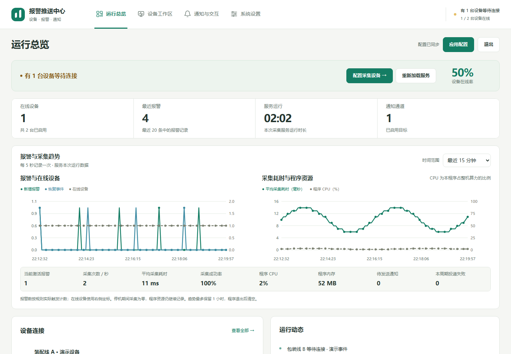
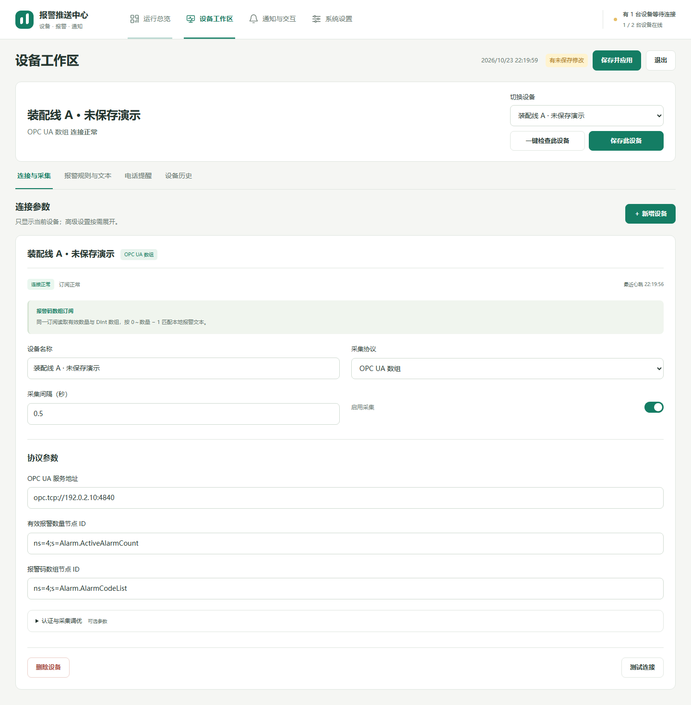

# 工作区与日常配置

[返回手册](README.md) · [安装](INSTALLATION.md) · [协议](PROTOCOLS.md) · [报警](ALARMS.md)

## 推荐配置顺序

1. 新增一台 Mock 设备，保持通知和电话关闭，保存后启动采集，确认运行总览有数据。
2. 把真实设备作为独立设备添加，配置地址、节点和轮询间隔，一键检查该设备。
3. 在该设备下创建规则，导入报警字典，确认有效报警与恢复能正确识别。
4. 添加通知目标，先发送测试消息，再启用正式发送。
5. 有交互需求时配置管理员、按钮和 PLC 地址，先用 Mock 测试确认流程。
6. 最后启用电话提醒，检查网关并在确认号码后测试一通。

新配置只在保存/应用后供正式采集使用；测试连接、通知测试与一键检查读取的是当前表单草稿，两者不能混为一谈。

## 页面组织

Windows 顶部导航按运行总览、设备配置、报警规则、通知与交互、运行记录组织；电话条件放在当前设备里。OpenWrt 顶部导航与窄屏底部导航提供同一组主要工作区，系统设置内部再按采集服务、账户与安全、手机连接、电话网关、高级与帮助分类。

## 运行总览

| 内容 | 怎么读 |
| --- | --- |
| 已连接 / 启用设备 | 已成功读取的设备与参与采集的设备数量；不是手机或路由器终端数量 |
| 当前有效报警 | 在线设备当前激活报警，断线后的旧值不继续当作实时状态 |
| 最后心跳 | 最近成功采集时间；采集失败时显示具体错误 |
| 连接时长 | 当前连续连接维持时间，重连后重新计时 |
| 报警与恢复曲线 | 每个采样周期新增的规则事件；同一信号匹配多条规则可能多次计数 |
| 采集曲线 | 平均读取耗时、每秒读取数、成功率 |
| CPU / 内存 | 报警进程的资源占用；不是 OpenWrt 整机负载 |
| 推送队列 / 失败 | 排队待发送数、最近采样周期最终失败数 |

曲线每 5 秒采样，支持最近 5 分钟、15 分钟、1 小时。需要至少两个真实样本才绘图。重启进程会清空内存趋势；历史报警另存文件，不受页面刷新影响。详细口径见[运行趋势](RUNTIME_TRENDS.md)。

## 设备工作区

1. 用设备选择器切换目标；新增时先取有辨识度的名称，例如“包装线 PLC”。每台设备拥有独立 ID、连接参数、启用状态和电话提醒。
2. 选择协议后填写必需参数。地址、OPC 节点等常用项优先显示，认证与调优在高级区域。长节点 ID 可直接粘贴，密码字段支持显隐。
3. 轮询间隔用秒填写，例如 `0.5`。OPC 订阅参数中的发布/采样间隔用毫秒，不能混填。
4. 打开该设备的报警规则与文本页，所有规则必须明确关联这台设备。不要为了复用名称把规则挂到另一台设备。
5. 一键检查使用草稿核对参数、规则和连接；启用电话时也检查网关。**不会保存、发消息、拨号或写 PLC**。参数变化后旧检查结果失效，应重新检查。
6. OpenWrt“保存此设备”只提交当前设备及所属规则，保留其他设备和通知草稿；顶栏“保存并应用”及 Ctrl+S 提交全部草稿。运行中应用配置会重新加载采集，连接与电话计时重新开始。
7. Windows“保存配置”写入文件，运行中修改后停止并重新启动监控，让正式采集使用新配置。只切换条目不等于保存到磁盘。
8. 删除设备前先处理关联规则；删除会丢失该配置，操作前备份。

“启用设备”决定是否参与下一次采集；主监控未启动时，即使设备启用也不会建立 PLC 连接。界面可以打开但全部离线时，先检查监控是否启动。

## 保存、测试、应用的区别

| 操作 | 写配置文件 | 实际网络行为 |
| --- | --- | --- |
| 测试设备连接 / 一键检查 | 否 | 连接当前草稿指定的设备，读取诊断数据 |
| 测试通知目标 | 否 | 实际发送一条测试消息 |
| 检测电话网关 | 使用已保存网关配置 | 登录并读取网关状态，不拨号 |
| 测试电话 | 否 | 核对号码并确认后真实拨号 |
| 按钮预览 | 否 | 本地预览，不发送、不写 PLC |
| 保存配置 / 保存并应用 | 是 | OpenWrt 会重新加载正在运行的采集 |
| 机器人 PLC 确认执行 | 否 | 对指定设备实际写入 |

未保存状态会在界面提示。网页离开或关闭时如有草稿会提醒；不要依赖浏览器关闭提醒作为备份。

## 运行记录与历史

实时日志用于排查连接、规则与发送问题；历史报警用于按设备回看触发和恢复，二者用途不同。先选择设备，再查询其最近 20 条，按每页 10 条翻页。清除历史前核对设备并完成确认；Windows 历史清理有两次确认。手机和机器人也按设备分页。

不要把“历史中有报警”理解为设备当前还在报警；实时激活状态请看连接与当前有效报警。更多见[报警历史](ALARMS.md#历史报警)。
