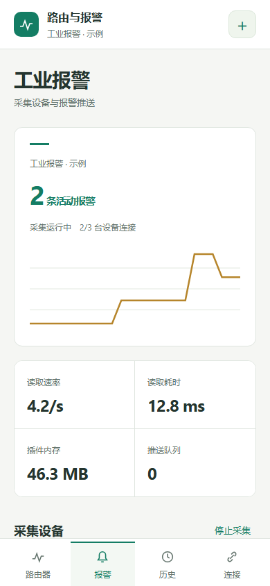

# 手机 App 功能与连接

[返回手册](README.md) · [安卓与 iPhone 安装](INSTALLATION.md#安卓-app) · [原生工程](../mobile/README.md)

安卓和 iPhone 使用相同的四个工作区：路由器、报警、历史、连接管理。窄屏支持底部导航和安全区域。App 是已有路由器/报警插件的操作端，不在手机后台独立运行 PLC 采集。

## 报警插件扫码

1. 升级报警插件到支持手机授权的版本，推荐 OpenWrt 1.7.0。
2. 浏览器登录插件，在“系统设置 → 手机连接”填写可访问地址。局域网可填路由器插件端口；公网应填插件 HTTPS 域名。不要填 LuCI 地址。
3. 生成二维码。二维码有效 **2 分钟**，只能使用一次；它含临时配对信息，不含管理密码。
4. 手机点“报警 → 扫描插件二维码”，允许相机，核对插件名称和地址后确认。也可用“粘贴连接码”。
5. 配对后可以查看设备状态、趋势、近期事件，编辑单台设备连接参数，以及确认后启动/停止采集。改参数前核对目标设备；保存会影响后台采集。
6. 完整规则、字典、机器人与电话设置仍从插件网页管理，手机 App 没有复刻全部管理表单。

扫码**只对应报警插件**，不会拿到 root 密码或登录路由器。插件服务停止、域名不通或手机没有对应局域网路由时，扫码令牌不能修复网络。

## 路由器账号连接

1. 在“路由器”或“连接管理”添加地址、OpenWrt 用户和密码。
2. App 通过 `/ubus` 读取系统、硬件、接口、无线与终端数据；路由器需提供对应接口和账号权限。
3. 展示系统运行时间、CPU、内存、接口收发、无线状态与终端记录。
4. CPU 百分比和速率需要两次采样；接口累计字节不是速率。终端记录不等于当前在线数量。
5. 个别接口权限不足时会提示部分数据不可用，不要把空值理解为 0。

路由器登录会话与插件令牌分别保存在系统安全存储中。路由器原始密码不持久保存；会话失效后重新登录。Android 使用 Keystore，iPhone 使用 Keychain。

## 历史报警

从“历史”选择报警插件及设备（也可查看全部），返回最近 20 条，每页 10 条。支持翻页和刷新；网络失败会显示错误。当前激活状态请看“报警”页实时设备信息，不以旧历史推断设备在线。

## 多个连接与撤销

- 可以添加多个路由器和插件，页面选择器切换当前连接。
- “连接管理 → 移除”删除手机本地保存的连接，不卸载路由器插件。
- 插件网页管理员可以撤销某台手机授权；丢手机时应在网页撤销，不只删二维码截图。
- 插件最多授权 20 台手机，令牌 30 天有效，过期或改管理密码后需要重新配对。
- 更新时使用相同原生包标识与签名，避免连接资料丢失。

## 地址、权限与边界

- 公网地址用 HTTPS，必须证书有效；自签或过期服务证书可能被系统拒绝。
- 内网 HTTP 仅允许私有地址；iPhone 当前额外允许默认地址 `192.168.1.1`。优先使用 HTTPS 保持两端一致。
- 直连 IPv6 要求手机外部网络有 IPv6；Cloudflare Tunnel 等反向入口的可达性由部署决定，App 不会自动创建隧道。
- 每 5 秒前台轮询，进入后台暂停；本版没有系统推送、离线通知或后台常驻。App 关闭不影响路由器已经运行的采集与通知。
- 浏览器开发预览不持久保存原生授权，不能当正式跨域客户端。
- 手机端暂不直接操作随身 WiFi 拨号，电话由 Windows 或 OpenWrt 后台配置和执行。
