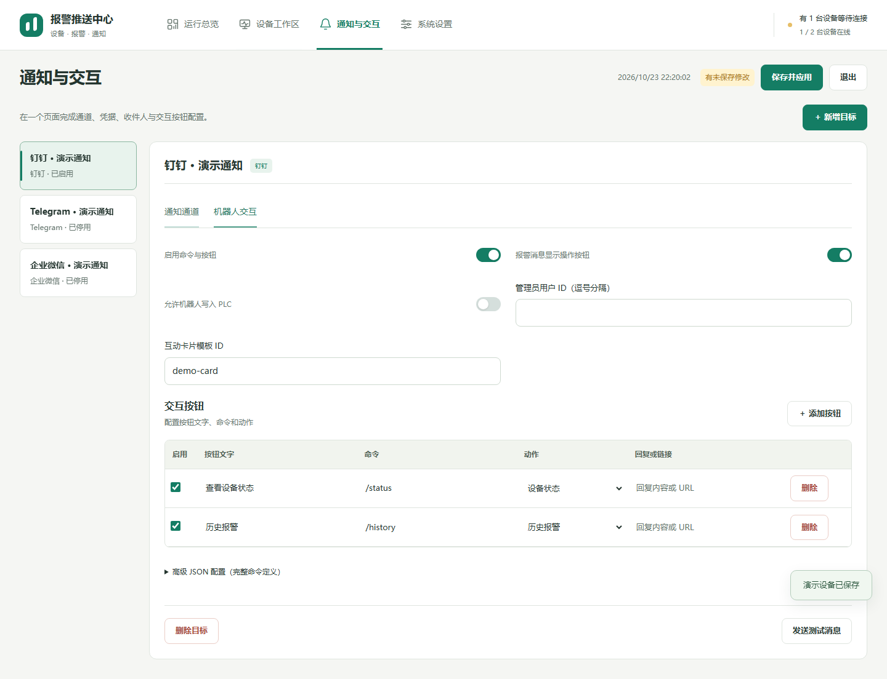

# 通知目标、机器人与 PLC 按钮

[返回手册](README.md) · [报警规则](ALARMS.md) · [电话提醒](PHONE.md)

## 通知目标的基本操作

在“通知与交互”新增目标，填写名称并选择渠道。通知通道和交互机器人共同编辑当前目标，不必为同一个机器人重复建两份。

1. 填写凭据及接收对象，先关闭 PLC 控制。
2. 点击“测试当前目标”。测试会真实发送消息，并使用当前表单草稿。
3. 成功后启用发送并保存/应用，再让正式报警触发。
4. 需要收指令时打开“接收命令”，配置管理员与动作，然后重启/应用采集服务。

发送测试成功只证明该目标本次能投递，不证明设备规则已触发。正式通知采用保存后的配置。每个目的地有独立内存队列，最多 1000 条；失败最多尝试 3 次，间隔 5 秒。停止或退出会取消未发消息，网络超时重试可能产生重复消息。

## Telegram

| 配置 | 说明 |
| --- | --- |
| Bot Token | 机器人令牌，不是用户名或群链接 |
| 会话 ID | 每行一个数字 chat ID，群可能带负号 |
| 管理员 ID | 数字用户 ID，每行一个；不是 chat ID |
| 接收命令 | 开启长轮询交互，不能与同一机器人的 Webhook / 其他 getUpdates 进程冲突 |

个人需要先与机器人开始对话；群需要添加机器人并赋予适当权限。填好目标测试发送，再发 `/start` 或 `/menu` 查看按钮。

## 钉钉企业应用机器人

这是企业应用 Client ID + Client Secret 接入，不要求把密钥拼成群 Webhook。

1. 在钉钉开放平台准备企业应用机器人，启用并发布到相应可见范围；需要指令/按钮回调时启用 Stream。
2. 本项目目标选钉钉，填写同一应用的 Client ID、Client Secret。
3. 接收方式为“个人”：每行填企业成员 **userId / staffId**，不是手机号、unionId。收件人必须在应用可见范围。
4. 接收方式为“群”：填写 **openConversationId**，机器人需已进群。或者保存并开启接收命令，启动后在目标群 @机器人发送 `/status`，让程序记录群 ID，再刷新查看。
5. 应用需有机器人发送消息权限。仅发文本时不需要卡片模板；真正按钮需要互动卡片模板、卡片写入/投放权限与 Stream 回调。
6. 按[互动卡片模板说明](../钉钉互动卡片模板说明.md)创建并发布模板，将模板 ID 填入客户端。
7. 在交互页开启“报警推送显示操作按钮”，保存/应用，再触发一条新报警验证。只有发指令后出现卡片、报警仍是文本时，重点核对这个开关、模板 ID 和正式采集是否使用新配置。

缺少群 ID、模板或权限会导致报错或回退文本提示。不要反复更换 Client Secret 来解决“userId 不存在”或“群会话未记录”。测试失败先按返回信息核对接收对象、应用范围和权限。

已有自定义群机器人也可用 Webhook 推送普通文本；它不等同于企业应用 Stream 交互。不要混填两套凭据期待自动完成按钮回调。

## 企业微信

- 仅推送：填写企业微信群机器人 Webhook。
- 交互：使用支持长连接的智能机器人，填写 Bot ID 和 Secret，启用接收命令。程序接收文本、进入会话和模板卡片事件。
- 管理员用企业成员 `userid`，每行一个；普通 Webhook 机器人不能因为填了管理员就变成长连接机器人。
- 确认你配置的是当前目标对应的机器人类型，测试推送与测试按钮分别验证。

## 飞书 / 自定义 Webhook

- 飞书当前用于 Webhook 通知；不提供与 Telegram 同等的交互接收。
- 自定义 Webhook 填 HTTP/HTTPS 回调地址，`payload_template` 默认 `{"text":"{message}"}`。对端需接受对应 JSON；先用测试消息验证字符、换行和 HTTP 状态。
- 这两种渠道不能作为 PLC 按钮回调平台使用。外部系统的鉴权、签名与限流需求应与对端协议一致；现有字段未覆盖的能力不应假定已经实现。

## 机器人交互

连接配置包含：接收命令开关、管理员 ID、欢迎语、未知指令回复、按钮列数、允许 PLC 写入、报警是否显示按钮。欢迎语/回复可用 `{user}`、`{args}`、`{time}`、`{status}` 等相应上下文变量。

每个动作有独立命令、按钮文字、启用开关和动作类型。命令应唯一并使用 `/status` 这样的形式；按钮名称要体现具体操作，不要留下多个含义相同的“新动作”。

| 动作 | 配置与运行结果 |
| --- | --- |
| 自定义回复 | 填回复文本；收到对应命令后返回 |
| 查询运行状态 | 返回连接数、设备心跳、连接时长及有效报警等运行信息 |
| 查看历史报警 | 先选已连接设备，显示最近 20 条，每页 10 条 |
| 显示菜单 | 返回可操作菜单，超过六项会分页 |
| 打开链接 | 填完整 HTTP/HTTPS 链接 |
| 写入 PLC | 选设备并填写协议相关写入地址、类型、值及脉冲 |

完整菜单在 `/start`、`/menu` 和菜单翻页时展示；报警按钮由“报警推送显示操作按钮”单独决定。普通回复、状态/历史和执行结果使用返回菜单入口，不在每条消息下无限重复整套按钮。

### PLC 写入与脉冲

1. 同时开启目标的“允许 PLC 写入”和当前动作启用开关，把实际执行者加入管理员。
2. 选择正确的设备。支持 Mock、OPC UA、S7、可写 Modbus 线圈/保持寄存器。
3. OPC UA 填可写 **NodeId**、服务器节点真实数据类型、写入值。BOOL 使用 Boolean；DInt 对应有符号 32 位整数；不能把报警数量节点随意当复位节点。
4. S7 填 DB 号、字节偏移、位编号及写入类型；Modbus 填零基地址与写入类型，核对范围与权限。
5. 脉冲毫秒为 0 表示保持写入；大于 0 时先写目标值，等待后恢复。OPC UA 还需明确恢复值，例如 Boolean 写 true、650 毫秒后恢复 false。
6. 先用本地按钮预览检查配置，再在 Mock 上测试流程。真实设备测试前核对现场状态。
7. 机器人显示设备、地址、类型、值和脉冲，并要求 **60 秒内二次确认**。确认与当前用户及会话绑定、只能消费一次；超时后重新发起。

管理员权限、目标允许写入、动作启用、地址正确与 PLC 可写权限都必须满足。界面显示“写入成功”仅代表驱动操作返回成功，仍应核对 PLC 反馈。脉冲恢复受到网络/设备连接影响，不能用于替代现场安全联锁。
