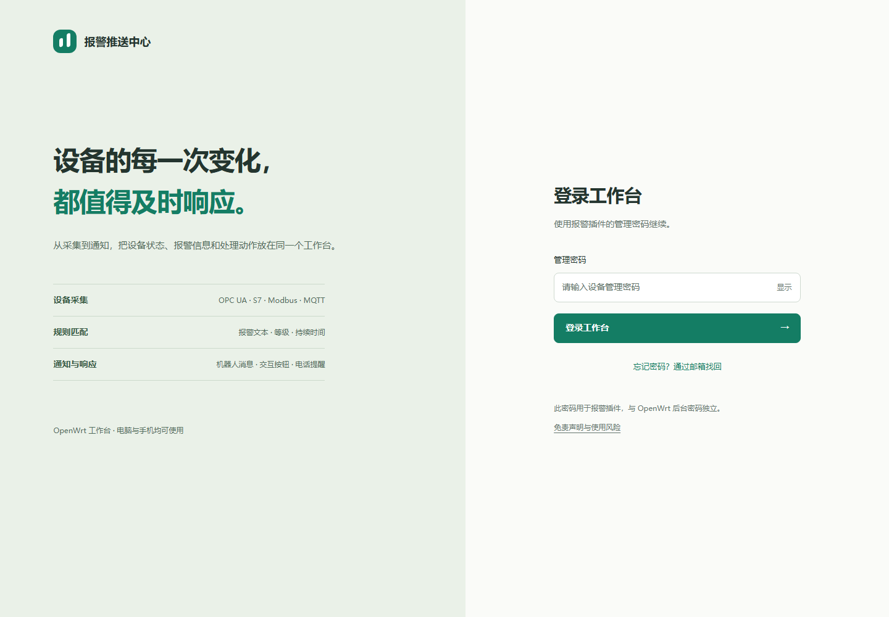

# 系统设置、密码与备份

[返回手册](README.md) · [安装与启动](INSTALLATION.md) · [手机授权](MOBILE.md)

## 系统设置各分区

| 分区 | 功能 |
| --- | --- |
| 采集服务 | 运行状态、启停采集、服务启动后的采集偏好 |
| 账户与安全 | 修改管理密码、邮箱找回、相关账户设置 |
| 手机连接 | 设置外部地址、生成配对码、查看和撤销手机授权 |
| 随身 WiFi 电话网关 | 网关地址、口令、AT 槽位、检测及测试 |
| 高级与帮助 | 脱敏配置预览、使用指引与免责声明 |

## 三种口令不要混用

| 登录位置 | 使用哪一个 |
| --- | --- |
| LuCI / SSH | OpenWrt 的系统账号密码，例如 root 的密码 |
| `:5080` 报警管理页面 | 报警插件独立管理密码 |
| 随身 WiFi UFI-TOOLS | 其原始登录口令 |

以上都不是手机扫码令牌。公开包没有统一固定的 `admin` 或 `password` 密码；OpenWrt 首次安装随机生成插件管理密码。

## 修改管理密码

1. 已登录插件后进入“账户与安全”。
2. 填当前密码、新密码和确认；新密码至少 8 个字符，最多 128 个字符。
3. 保存修改后重新登录。已有管理会话和手机授权会失效，需要重新扫码。
4. 此操作不修改路由器 root 密码、不修改随身 WiFi 口令。

## 邮箱找回

找回功能必须在忘记密码之前配置并验证 SMTP，不能在完全没有邮件设置时自动知道你的邮箱。

1. 在账户与安全启用邮箱找回，展开邮件设置。
2. 填接收找回邮件的邮箱、SMTP 主机、端口、发信地址、认证用户名和 SMTP 密码/授权码，并填写当前管理密码确认保存。
3. SMTP 必须支持 STARTTLS，通常为端口 587；当前不支持 465 隐式 TLS，也没有任意 TLS 模式选择。密码通常是服务商专用授权码，不一定等于邮箱网页登录密码。
4. 保存后通过登录页申请一次验证码，确认能收到后再依赖此功能。没有单独的“测试邮件”按钮；验证时保留当前已登录会话，不必真的重置密码。邮件可能进垃圾箱；路由器需有 DNS 和外网访问能力。
5. 忘记时点击登录页“忘记密码”，按页面申请验证码，并在有效期内输入验证码及新密码。限流或过期时按提示等待/重新申请。
6. 找回重置后重新登录并重新授权手机。

从未配置有效 SMTP 且忘记管理密码时，需要通过仍可用的 OpenWrt 管理入口处理，先备份 `/etc/alarm-push-center`。不要直接删除整个配置目录来“重置”，这会连设备、机器人和电话设置一并丢失。

## 配置与备份位置

| 平台 | 内容 |
| --- | --- |
| Windows 安装版 | `%LOCALAPPDATA%\AlarmPushCenter`；自定义 `--config` 时以指定目录为准 |
| OpenWrt | `/etc/alarm-push-center` |
| `config.json` / `.bak` | 设备、规则、通知目标及机器人凭据；保存使用临时文件和原子替换 |
| `phone-gateway.json` | 电话网关及其口令 |
| `console-settings.json` 等插件状态文件 | 管理与找回设置，按整个目录备份以免漏文件 |
| `mobile-devices.json` | 手机授权状态 |
| `alarm-history.jsonl` | 本地历史记录 |

备份整个配置目录最稳妥。不要把这些文件、邮件授权码、安卓签名密钥、Cloudflare 令牌或路由器维护记录上传 GitHub。脱敏预览用于诊断，不能代替完整私密备份。

## 域名与远程访问

报警插件域名应指向插件服务，路由器后台域名指向 LuCI，两者不同。手机配对中的地址必须是手机真正可访问的插件地址，例如 `https://alarm.example.com`，不要填路由器 LuCI 页面、`127.0.0.1` 或只有电脑能访问的地址。

使用 HTTPS 并保留登录保护。Cloudflare Tunnel 可让外网 IPv4/IPv6 访问入口；DNS-only AAAA 的 IPv6 直连则要求外部网络也具备 IPv6、正确防火墙和证书。这些是独立的网络部署，不会由安装 IPK 或 App 自动完成。本版安装包不包含任何人的域名密钥或隧道令牌。

软件不能替代现场联锁。完整使用范围见[免责声明](../DISCLAIMER.txt)。
