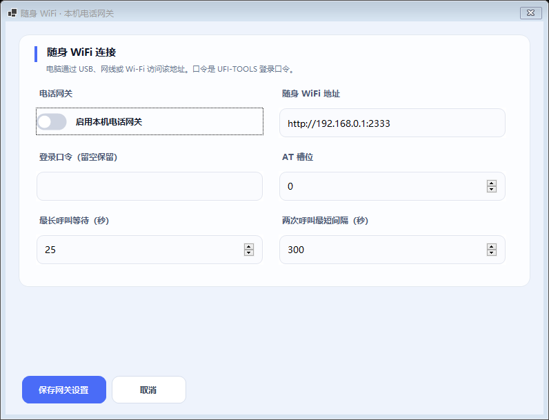
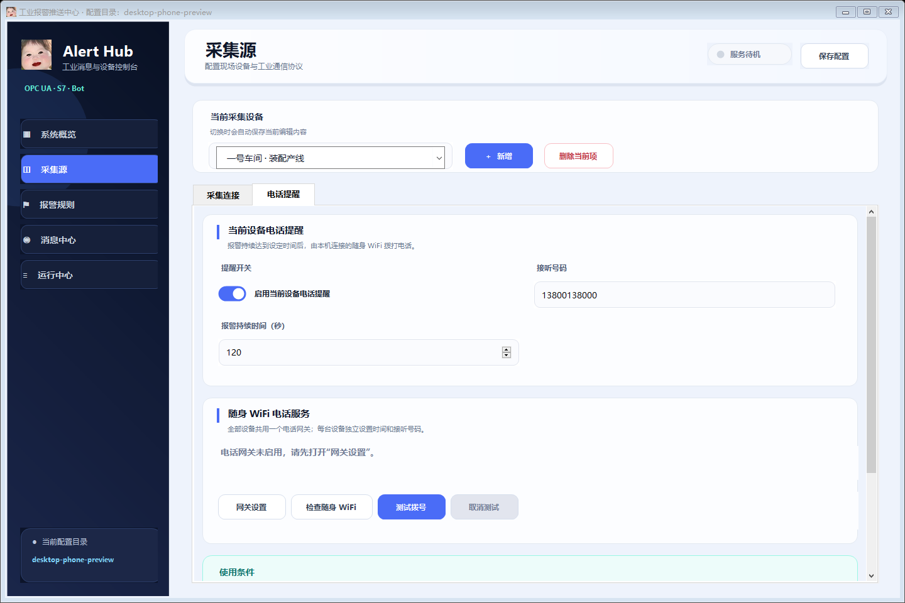

# Windows 客户端随身 WiFi 电话提醒（1.2.0）

Windows 客户端直接访问随身 WiFi 的 UFI-TOOLS 电话接口，不需要先连接 OpenWrt 报警插件。电脑负责采集报警和计时，随身 WiFi 负责使用 SIM 拨号。关闭电脑、退出客户端或停止采集后，客户端的自动电话提醒停止。

## 准备条件

- Windows 10 / 11 x64 电脑，安装 1.2.0 客户端。
- 随身 WiFi 已安装具有 AT 功能的 UFI-TOOLS，SIM 支持语音拨号，固件及 VoLTE 设置可用。普通仅上网的随身 WiFi 无法通过此功能拨号。
- 电脑通过 USB 网络、网线或 Wi-Fi 能访问随身 WiFi。默认示例地址为 `http://192.168.0.1:2333`，以设备实际地址为准。

已在现有 F50 / UFI-TOOLS 4.0.5 上验证过接口检测和独立拨号响铃。此版本增加了客户端自动触发接入；完整的现场 PLC 超时拨号仍需结合实际设备验证。

## 一、配置电话网关

1. 打开“采集源”，选择一台设备，切换到“电话提醒”。
2. 点击“网关设置”，开启“启用本机电话网关”。所有采集设备共用此网关。
3. 填写随身 WiFi 地址及 **UFI-TOOLS 登录口令原文**。程序自动转换为接口要求的认证值，不用手动计算；此处不是路由器 root 密码或报警插件管理密码。以后修改设置时口令留空可保留已保存口令。
4. AT 槽位通常先用 0；槽位是 AT 执行通道，不一定与界面的 SIM 卡编号相同。
5. 最长呼叫等待默认 25 秒，范围 5～60 秒；两次呼叫最短间隔默认 300 秒，范围 60～3600 秒。
6. 保存网关设置，点击“检查随身 WiFi”。检查会验证设备、口令、SIM 就绪及空闲状态，**不会拨号**。无需先填写当前设备的接听号码即可检查网关。

网关配置保存在当前 `config.json` 所在目录的 `phone-gateway.json`。安装版通常位于 `%LOCALAPPDATA%\AlarmPushCenter\phone-gateway.json`。其中包含本机口令，应与机器人配置一样妥善保管，不要上传到公开仓库或分享配置目录。安装包不携带现场口令。

## 二、每台设备分别配置

1. 在顶部设备选择框选中设备；该选择框在滚动电话设置时保持可见。
2. 在“电话提醒”启用当前设备，填写接听号码和报警持续秒数。号码支持 7～15 位数字，可带前导 `+`。
3. 例如填写 120，表示命中启用规则的同一报警连续激活至少 120 秒后才尝试呼叫。每台设备可以使用不同号码、时间和开关。
4. 点击顶部“保存配置”。正在运行的采集需要停止后重新启动，新的设备设置才会生效；网关设置单独保存，即时生效。
5. 如需验证真实电话，点击“测试拨号”，核对弹窗中的号码后选择“是”。该操作可能产生通话费用，不必等待报警超时；使用当前填写的设备提醒及号码，不会自动保存未保存的设备编辑。
6. “取消测试”会取消检测或测试呼叫；已经发起的测试电话仍会尝试发送挂断命令。

## 三、自动提醒规则

- 只有命中已启用报警规则的激活报警才计时；当前实现按设备及报警码处理，重复规则不会重复拨打同一持续报警。
- 达到持续时间后，还须有最近有效采集数据，且网关启用、SIM 就绪、设备空闲。
- 同一轮持续报警只尝试一次真正拨号；恢复后再次出现才重新计时。请求超时也不会盲目重拨。
- 报警恢复、采集断线、停止采集或退出客户端会取消等待；已发起的自动电话会尝试挂断。
- 多条报警串行共用网关，受全局呼叫间隔限制。网关暂不可用时会等待后续检测，原有机器人消息继续工作。
- 接通或达到呼叫等待上限后挂断；当前只支持电话/响铃提醒，不播放报警语音。
- 若挂断时连接中断，程序只能记录“挂断未确认”，请到随身 WiFi 查看通话状态，不能保证已挂断。
- 不建议 Windows 和 OpenWrt 同时为同一报警开启电话提醒，两端计时及间隔独立，可能重复来电。

## 常见问题

| 提示或现象 | 检查方法 |
| --- | --- |
| 连接失败 | 先用这台电脑的浏览器打开随身 WiFi 地址，确认 IP、端口及网卡路由；电脑能访问 PLC 不代表能访问随身 WiFi。 |
| 口令验证失败 | 填写 UFI-TOOLS 登录口令原文；留空保留原值，不能用留空清除旧口令。 |
| SIM 未就绪 | 检查插卡、PIN 状态和 AT 槽位；语音拨号还需要 SIM 开通语音及固件支持。 |
| 正在通话 | 程序不会挂断其他已有通话；等待空闲后再试。 |
| 间隔保护 | 等待设置的全局最短间隔，不会因重新启停采集而绕过保护。 |
| 报警到时仍未拨打 | 检查采集运行状态、设备在线、规则匹配、该轮报警是否已拨过，以及网关忙碌或间隔保护。 |

## 验证记录

2026-10-23：Windows 编译、界面预览、设备电话配置隔离以及直接拨号控制器的模拟链路检查通过。模拟覆盖真实监控器持续报警触发、SHA256 口令认证、只读检查、取消后挂断、间隔限制及日志脱敏。此次开发过程没有向现场号码发起新电话；实际 PLC 持续报警到接听端响铃仍需用户现场确认。

使用前请阅读 [免责声明](../DISCLAIMER.txt)。
